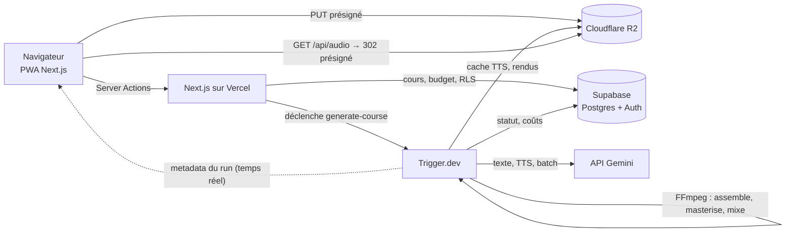
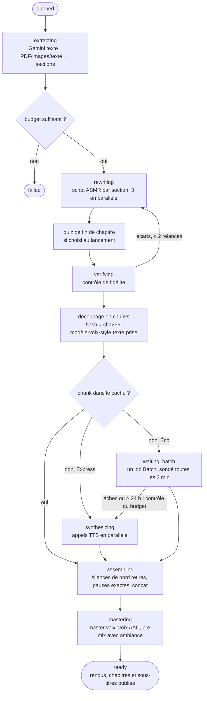
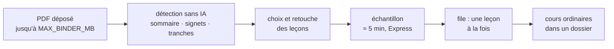
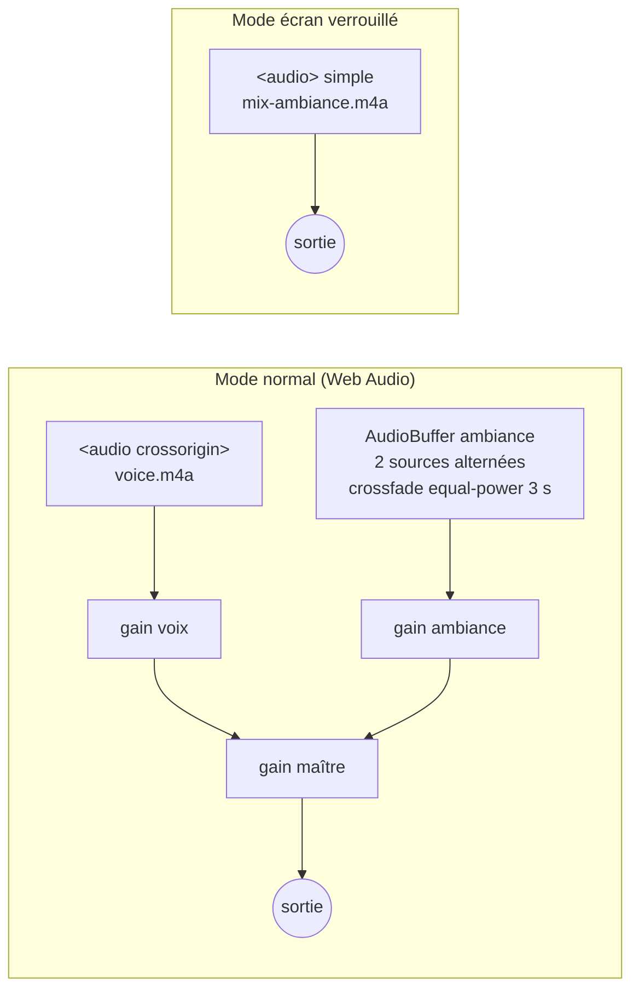

# Architecture de Murmure

Murmure transforme un cours (PDF, photos de notes, texte) en piste audio de révision chuchotée, avec chapitres, sous-titres et ambiance. Ce document décrit le chemin d'un cours, du dépôt à l'écoute. La spécification d'origine est dans [SPEC.md](SPEC.md), la mise en service dans [SETUP.md](SETUP.md).

## Vue d'ensemble

- **Next.js** sert l'interface, contrôle chaque action côté serveur (session, limites, budget) et délivre les URLs présignées. Il ne fait aucun traitement long.
- **Trigger.dev** exécute le pipeline. FFmpeg y est installé par l'extension de build.
- **Supabase** garde les données. Le navigateur ne peut que lire ses propres lignes (RLS), plus les cours et sections qu'un autre compte partage avec son adresse (`course_shares`, lecture seule) et ses dossiers (`folders`, `course_folders`) ; les écritures métier passent par le serveur avec la clé secrète, toujours filtrées par `user_id`.
- **R2** garde les fichiers. Le bucket est privé : tout accès passe par une URL présignée (15 min en dépôt, 6 h en lecture, le temps d'une longue écoute).

## Le pipeline

### Reprise et idempotence

`generateCourse` (`src/trigger/steps/orchestrate.ts`) enchaîne des étapes qui lisent chacune l'état en base et sautent ce qui est fait :

| Étape        | Déjà fait si…                                                            |
| ------------ | ------------------------------------------------------------------------ |
| Extraction   | le cours a des sections                                                  |
| Réécriture   | la section a un `script`                                                 |
| Quiz         | la section a un `quiz` (ou le cours est sans quiz)                       |
| Vérification | la section a un `verify_report`                                          |
| Synthèse     | le chunk est `done`, ou `tts-cache/{hash}.wav` existe                    |
| Batch        | `courses.batch_job_id` est renseigné : on reprend le sondage du même job |

Relancer la tâche reprend donc là où elle s'était arrêtée. L'assemblage et le mix ne font aucun appel IA et repartent toujours du cache : c'est ce qui rend gratuits le changement d'ambiance et la reprise après un échec de FFmpeg.

Les chunks sont un état dérivé : ils sont recalculés à chaque passage à partir des scripts, et ceux dont le hash n'a pas changé gardent leur audio. Régénérer une section ne paie donc que les passages modifiés.

### Étapes testables sans infrastructure

Les étapes reçoivent leurs dépendances (`PipelineDeps` : dépôt, stockage, IA, attente, horloge). Trois hôtes les fournissent :

| Hôte                                    | Dépôt          | Stockage          | IA          | Attente                 |
| --------------------------------------- | -------------- | ----------------- | ----------- | ----------------------- |
| Trigger.dev (`src/trigger/*.ts`)        | Supabase       | R2                | Gemini      | `wait.for` (checkpoint) |
| Inline (`JOBS_MODE=inline`, dev et E2E) | Supabase local | disque            | mock        | `setTimeout`            |
| Tests d'intégration                     | mémoire        | disque temporaire | mock compté | immédiate               |

### Découpage et silences

- Un chunk se termine après une pause d'au moins 1 000 ms, en fin de section, ou quand il dépasserait 900 caractères (coupe au segment portant la plus longue pause). Les segments étant des phrases, on ne coupe jamais une phrase.
- Les pauses longues ne sont pas laissées à la voix : FFmpeg retire les silences de début et de fin de chaque chunk, puis insère un silence de la durée exacte demandée. Les pauses courtes deviennent un espace ou la balise `<short pause>`.
- Chaque chunk reçoit un fondu de 10 ms à ses deux bords, puis est ramené au niveau médian du cours (4 dB au plus) : chaque appel TTS a son propre niveau.
- Une synthèse à la durée aberrante (passage tronqué ou parti en roue libre, hors de 5 à 28 caractères par seconde) est refaite une fois. La prise rejetée est facturée par Gemini, donc journalisée.
- « Refaire un passage » réenregistre un seul chunk sans toucher au script : le numéro de prise entre dans le hash (`courses.chunk_takes`), si bien que le cache ne répond plus et que seul ce passage est payé.
- « Réexplique-moi autrement » réécrit un seul passage (`reexplainChunk`) : le lecteur a noté sa légende de `captions.json` dans `passage_marks`, qui retrouve le chunk tant que le script n'a pas changé. Un appel texte reformule ses segments, plus simplement et avec un exemple ; ils remplacent l'original dans le script de la section, en gardant la pause qui suit pour que le découpage d'après ne bouge pas. Le cache par hash ne fait payer que les passages modifiés. Le rapport de fidélité de la section est gardé : un nouveau contrôle relancerait la réécriture de toute la section.
- Quiz de fin de chapitre (`courses.quiz`, choisi au lancement : « Pour réviser » ou « Pour s'endormir ») : après la réécriture, un appel texte par section écrit 2 ou 3 questions et leurs réponses d'après la source (`sections.quiz`). Le découpage ajoute en fin de section des chunks `kind = 'quiz'` : une transition, chaque question suivie d'un silence exact de 6 s pour répondre dans sa tête, puis la réponse. Transitions et silences sont écrits par le code : la transition sort du cache d'un chapitre à l'autre. Au dernier chapitre, la réécriture omet sa clôture, remplacée par une phrase de fin après le quiz. Le quiz ne dépend pas du script : régénérer une section ou réexpliquer un passage le gardent, et un passage du quiz se refait mais ne se réexplique pas.
- Les durées mesurées donnent la position de chaque chunk et de chaque section, d'où `captions.json`, `chapters.json` et les chapitres embarqués dans les fichiers audio.

### Budget

Chaque appel écrit une ligne dans `usage_events` avec son coût, calculé par `src/lib/pricing.ts` au tarif du jour (les tarifs doublent le 1er janvier 2027). Le budget est contrôlé trois fois, toujours côté serveur :

1. au lancement, sur l'estimation (refus au-delà du budget, confirmation au-delà de 80 %, Express désactivé au-delà de 80 %) ;
2. après l'extraction, quand la taille réelle du cours est connue. Ce contrôle (`budgetGate`) est rejoué à chaque passage tant qu'il reste du texte ou de la voix à produire : « Reprendre » un cours arrêté pour dépassement ne le contourne pas ;
3. avant un repli du Batch vers l'API standard, deux fois plus chère.

Les sommes sont faites en SQL (`spend_since`, `course_cost`, vues `monthly_spend` et `course_costs`) : une lecture ligne à ligne serait tronquée à 1 000 lignes par l'API. Chaque compte règle son budget (500 $ au plus, borné par la base) ; `GLOBAL_MONTHLY_BUDGET_USD` ajoute un plafond tous comptes confondus. Une lecture de dépense qui échoue fait refuser l'action, jamais l'accepter.

### Limites

Un seul cours en préparation par compte : c'est un index unique partiel qui le garantit, et les changements de statut sont conditionnels (deux clics ne lancent qu'une tâche). La limite quotidienne compte les lancements dans `course_launches`, que la suppression d'un cours n'efface pas. L'ambiance est vérifiée avant tout appel payant ; un changement d'ambiance qui échoue laisse le cours écoutable.

Le suivi de l'app reste une estimation : la console de facturation Google fait foi.

## Classeurs

Un polycopié de plusieurs cours (300 pages, 100 Mo et plus) ne passe pas en un seul cours : il dépasserait `MAX_PDF_PAGES`, et un essai raté coûterait tout le document. Il devient un **classeur** (`binders`, `binder_lessons`) :

- **Détection** (`src/lib/binder/detect.ts`, fonctions pures) : texte de chaque page avec unpdf (2 s pour 315 pages), puis le sommaire en tête du document (renvois « p39 », points de conduite, décalage de numérotation retrouvé d'après les titres), à défaut les signets du PDF, à défaut des tranches de 20 pages. Une leçon court jusqu'à la veille de la suivante ; les pages vides en bordure ne sont pas envoyées ; une leçon trop longue pour un cours est coupée en parts égales. Les caractères de chaque page sont gardés (`page_chars`) : l'écran réestime une leçon retouchée sans relire le PDF.
- **Découpe** (`src/lib/binder/pdf.ts`) : pdf-lib lit le PDF une fois et en tire une plage par leçon, déposée sous `uploads/{user}/{planned_course_id}/source.pdf` : supprimer le cours emporte ses pages.
- **Échantillon** : un cours `is_sample`, caché de la bibliothèque, fait du début d'une leçon (2 à 4 pages, sans la page de titre). Toujours en Express ; l'extraction n'en garde qu'une section d'environ 4 000 caractères (`sampleSection`). Un nouvel échantillon remplace le précédent.
- **File** (`src/lib/binder/queue.ts`) : à la fin de chaque tâche de cours (Trigger.dev ou inline), `afterCourseJob` met en pause le classeur d'une leçon en échec, puis `advanceBinders` lance la leçon suivante si plus rien n'est en préparation. Chaque leçon est contrôlée contre le plafond du budget (les 80 % ont été confirmés au lancement) ; au-delà, la file se met en pause avec un message, et reprend quand l'utilisatrice la relance (avec d'autres réglages si elle veut). Sous Trigger.dev, la leçon suivante est déclenchée depuis la tâche qui finit : elle attend dans la même file (`concurrencyKey`).
- Lancer une file compte pour un seul lancement dans `DAILY_COURSE_LIMIT`. Les leçons sont rangées dans un dossier au nom du classeur.

## Le lecteur

- La voix n'est jamais décodée en entier : elle est lue en flux par un élément `<audio>`. Seule l'ambiance, courte, est décodée et bouclée.
- Le gain maître porte les fondus : pause douce (300 ms) et minuteur de sommeil (30 s).
- Sur iOS, Web Audio est suspendu à l'écran verrouillé. Le lecteur y lit donc le pré-mix dans un `<audio>` simple ; l'ambiance est alors celle choisie au rendu.
- L'état suit une machine `idle → loading → playing ⇄ paused → ended` (`src/lib/player/machine.ts`).

## Hors-ligne

Le lecteur ne connaît que des adresses stables, `/api/audio/{cours}/{fichier}`, qui redirigent vers une URL présignée. « Télécharger » range ces adresses dans Cache Storage (`murmure-audio-v1`) sous forme de réponses complètes, avec la page du lecteur. Le service worker (`src/app/sw.ts`) répond ensuite depuis ce cache et découpe lui-même les plages `Range` que demande l'élément audio. La clé de cache ne dépend donc jamais d'une signature présignée.

Les copies hors-ligne suivent le compte : la déconnexion vide le cache, une page de lecteur qui répond 404 (cours supprimé, partage retiré) emporte ses fichiers, et un nouveau déploiement recharge les pages de lecteur gardées.

### Mastering

- Timbre (passe-haut, de-esser, compresseur, chaleur), puis mise au niveau en deux passes : `loudnorm` mesure la piste, puis applique un gain fixe. En une passe, il ajuste le gain au fil de l'eau et pompe sur du chuchoté.
- La voix sort en stéréo, avec un balancement lent et discret d'une oreille à l'autre (`MASTER.stereoDrift`), sur un fond de pièce continu à −62 dB (`MASTER.roomToneDb`) : sans lui, chaque pause tombe au silence numérique. Les deux se coupent en mettant la constante à `null` dans `src/lib/audio/master.ts`.
- L'aperçu d'une voix dans le Studio passe par la même chaîne, au modèle standard.

## Machine Trigger.dev

Mesure du 13 octobre 2026 (`scripts/bench-pipeline.ts`, mode mock, vrai FFmpeg, 81 minutes d'audio en 448 chunks) :

| Mesure                                      | Valeur                                   |
| ------------------------------------------- | ---------------------------------------- |
| Durée totale sur un cœur rapide             | 150 s, dont 142 s de mastering et de mix |
| Mémoire au pic (processus le plus gourmand) | 139 Mo                                   |
| Disque temporaire au pic                    | 1,2 Go                                   |
| Rendus                                      | voix 50 Mo, pré-mix 76 Mo                |

Le mastering est mono-thread et le pipeline travaille sur disque. `small-2x` (1 vCPU, 1 Go) est la plus petite machine qui garde de la marge mémoire ; elle est fixée dans `src/trigger/shared.ts`. Cette mesure est locale et date d'avant le mastering en deux passes, qui prend environ 2,4 fois plus de temps (13 s contre 5 s pour 5 minutes d'audio) : le temps réel sur Trigger.dev reste à relever sur un premier vrai cours.
