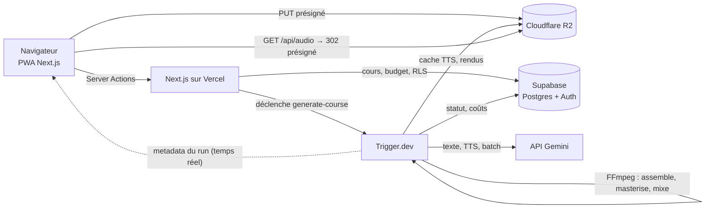
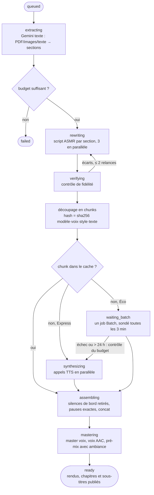
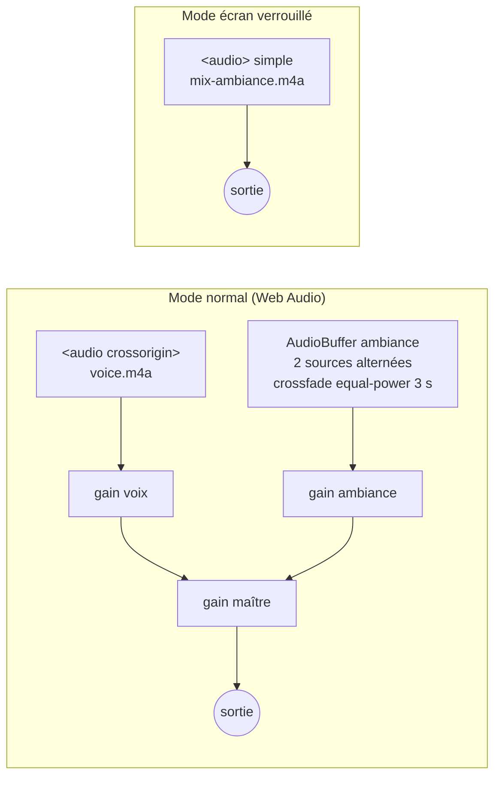

# Architecture de Murmure

Murmure transforme un cours (PDF, photos de notes, texte) en piste audio de révision chuchotée, avec chapitres, sous-titres et ambiance. Ce document décrit le chemin d'un cours, du dépôt à l'écoute. La spécification d'origine est dans [SPEC.md](SPEC.md), la mise en service dans [SETUP.md](SETUP.md).

## Vue d'ensemble

- **Next.js** sert l'interface, contrôle chaque action côté serveur (session, limites, budget) et délivre les URLs présignées. Il ne fait aucun traitement long.
- **Trigger.dev** exécute le pipeline. FFmpeg y est installé par l'extension de build.
- **Supabase** garde les données. Le navigateur ne peut que lire ses propres lignes (RLS) ; les écritures métier passent par le serveur avec la clé secrète, toujours filtrées par `user_id`.
- **R2** garde les fichiers. Le bucket est privé : tout accès passe par une URL présignée courte.

## Le pipeline

### Reprise et idempotence

`generateCourse` (`src/trigger/steps/orchestrate.ts`) enchaîne des étapes qui lisent chacune l'état en base et sautent ce qui est fait :

| Étape        | Déjà fait si…                                                            |
| ------------ | ------------------------------------------------------------------------ |
| Extraction   | le cours a des sections                                                  |
| Réécriture   | la section a un `script`                                                 |
| Vérification | la section a un `verify_report`                                          |
| Synthèse     | le chunk est `done`, ou `tts-cache/{hash}.wav` existe                    |
| Batch        | `courses.batch_job_id` est renseigné : on reprend le sondage du même job |

Relancer la tâche reprend donc là où elle s'était arrêtée. L'assemblage et le mix ne font aucun appel IA et repartent toujours du cache : c'est ce qui rend gratuits le changement d'ambiance et la reprise après un échec de FFmpeg.

Les chunks sont un état dérivé : ils sont recalculés à chaque passage à partir des scripts, et ceux dont le hash n'a pas changé gardent leur audio. Régénérer une section ne paie donc que les passages modifiés.

### Étapes testables sans infrastructure

Les étapes reçoivent leurs dépendances (`PipelineDeps` : dépôt, stockage, IA, attente, horloge). Trois hôtes les fournissent :

| Hôte                                    | Dépôt          | Stockage          | IA          | Attente                 |
| --------------------------------------- | -------------- | ----------------- | ----------- | ----------------------- |
| Trigger.dev (`src/trigger/*.ts`)        | Supabase       | R2                | Gemini      | `wait.for` (checkpoint) |
| Inline (`JOBS_MODE=inline`, dev et E2E) | Supabase local | disque            | mock        | `setTimeout`            |
| Tests d'intégration                     | mémoire        | disque temporaire | mock compté | immédiate               |

### Découpage et silences

- Un chunk se termine après une pause d'au moins 1 000 ms, en fin de section, ou quand il dépasserait 900 caractères (coupe au segment portant la plus longue pause). Les segments étant des phrases, on ne coupe jamais une phrase.
- Les pauses longues ne sont pas laissées à la voix : FFmpeg retire les silences de début et de fin de chaque chunk, puis insère un silence de la durée exacte demandée. Les pauses courtes deviennent un espace ou la balise `<short pause>`.
- Les durées mesurées donnent la position de chaque chunk et de chaque section, d'où `captions.json`, `chapters.json` et les chapitres embarqués dans les fichiers audio.

### Budget

Chaque appel écrit une ligne dans `usage_events` avec son coût, calculé par `src/lib/pricing.ts` au tarif du jour (les tarifs doublent le 1er janvier 2027). Le budget est contrôlé trois fois, toujours côté serveur :

1. au lancement, sur l'estimation (refus au-delà du budget, confirmation au-delà de 80 %, Express désactivé au-delà de 80 %) ;
2. après l'extraction, quand la taille réelle du cours est connue ;
3. avant un repli du Batch vers l'API standard, deux fois plus chère.

Le suivi de l'app reste une estimation : la console de facturation Google fait foi.

## Le lecteur

- La voix n'est jamais décodée en entier : elle est lue en flux par un élément `<audio>`. Seule l'ambiance, courte, est décodée et bouclée.
- Le gain maître porte les fondus : pause douce (300 ms) et minuteur de sommeil (30 s).
- Sur iOS, Web Audio est suspendu à l'écran verrouillé. Le lecteur y lit donc le pré-mix dans un `<audio>` simple ; l'ambiance est alors celle choisie au rendu.
- L'état suit une machine `idle → loading → playing ⇄ paused → ended` (`src/lib/player/machine.ts`).

## Hors-ligne

Le lecteur ne connaît que des adresses stables, `/api/audio/{cours}/{fichier}`, qui redirigent vers une URL présignée. « Télécharger » range ces adresses dans Cache Storage (`murmure-audio-v1`) sous forme de réponses complètes, avec la page du lecteur. Le service worker (`src/app/sw.ts`) répond ensuite depuis ce cache et découpe lui-même les plages `Range` que demande l'élément audio. La clé de cache ne dépend donc jamais d'une signature présignée.

## Machine Trigger.dev

Mesure du 13 octobre 2026 (`scripts/bench-pipeline.ts`, mode mock, vrai FFmpeg, 81 minutes d'audio en 448 chunks) :

| Mesure                                      | Valeur                                   |
| ------------------------------------------- | ---------------------------------------- |
| Durée totale sur un cœur rapide             | 150 s, dont 142 s de mastering et de mix |
| Mémoire au pic (processus le plus gourmand) | 139 Mo                                   |
| Disque temporaire au pic                    | 1,2 Go                                   |
| Rendus                                      | voix 50 Mo, pré-mix 76 Mo                |

Le mastering est mono-thread et le pipeline travaille sur disque. `small-2x` (1 vCPU, 1 Go) est la plus petite machine qui garde de la marge mémoire ; elle est fixée dans `src/trigger/shared.ts`. Cette mesure est locale : le temps réel sur Trigger.dev reste à relever sur un premier vrai cours.
